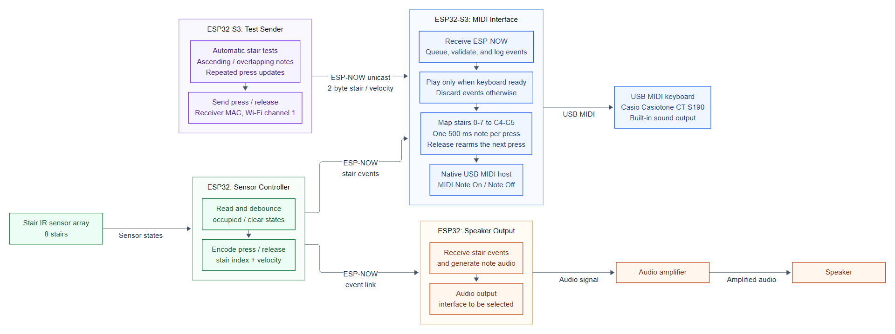

# Musical Stairs

More coming soon!

## System Block Diagram



## MIDI Interface

See [stepSensor/README.md](stepSensor/README.md) for the IR step sensor firmware,
including wiring, per-stair configuration, diagnostic LEDs, and ESP-NOW messages
to the MIDI receiver.

See [midi_interface/midi_esp32s3/README.md](midi_interface/midi_esp32s3/README.md) for the ESP32-S3 MIDI receiver. It receives stair press/release messages over ESP-NOW and sends USB MIDI notes to the Casio Casiotone CT-S190. The README covers keyboard wiring, building, and debugging.

See [midi_interface/test_espnow_esp32s3/README.md](midi_interface/test_espnow_esp32s3/README.md) for the ESP-NOW test sender. A second ESP32-S3 automatically tests ascending stairs, overlapping notes, and repeated presses without buttons or sensors.

Set `receiver_mac` in the test sender's `main/esp_now_test_sender.c` to the receiver's printed `MIDI receiver MAC`. Keep `STAIR_WIFI_CHANNEL` the same on both boards. The default is channel 1. Radio reception can be checked without a keyboard, but audio requires a connected and ready MIDI device.

See [midi_interface/wokwi_simulation/README.md](midi_interface/wokwi_simulation/README.md) for the Wokwi button/serial simulation and browser import steps. It tests the note logic without ESP-NOW or audio output.

Each press plays one `NOTE_DURATION_MS` note: 500 ms by default on the MIDI receiver and 300 ms in Wokwi. ESP-NOW senders use a two-byte stair/velocity message: velocity `1-127` means press and `0` means release. Releases rearm the next press; holding a stair does not repeat its note.

## Minimal ESP Instructions

Open an ESP-IDF enabled powershell prompt

```powershell
cd <to/target/directory>

idf.py set-target esp32 # for ESP32
idf.py set-target esp32s3 # for ESP32-S3

idf.py build

idf.py flash monitor # auto detects active ESP module, flashes the board, and opens a serial monitor
idf.py -p COM5 flash monitor # manually overrides ESP COM location

Ctrl+] # exit the serial monitor

# If you need help finding the correct COM port
[System.IO.Ports.SerialPort]::GetPortNames()
python -m esptool -p <COM_PORT> chip-id
```

## Mermaid Instructions

Requires Node.js and Mermaid CLI 12. The diagram uses ELK layout for
connector routing, with rendering settings in `docs/mermaid/config.json`.

```powershell
npm install -g @mermaid-js/mermaid-cli@12

cd .\docs\mermaid
mmdc -i block_diagram.mmd -o block_diagram.png --scale 3 --size 1920 -c config.json

mmdc -i block_diagram.mmd -o block_diagram.png --scale 1 --size 1920 -c config.json
```

For interactive editing, use [Mermaid Live](https://mermaid.live/); include the
settings from `config.json` when previewing the layout.
